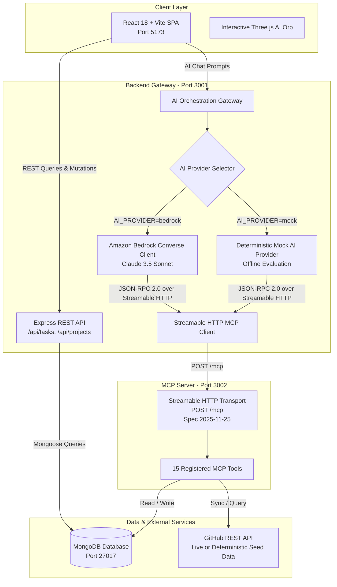

# 🚀 QLYQ

> **MCP-Powered AI Project and Developer Assistant**  
> *Think less. Ship more.*  
> *Built for the Amazon Developer Hackathon 2026*  
> **Primary Track: Alexa+** | **Mini Challenges: AWS Builder · Open Source**

---

[](https://modelcontextprotocol.io)
[](https://modelcontextprotocol.io)
[](https://aws.amazon.com/bedrock/)
[](LICENSE)
[](mcp-audit.mjs)

---

## 💡 Overview

**QLYQ** (*Think less. Ship more.*) is an autonomous developer productivity assistant that coordinates tasks, project priorities, and GitHub workflows through an agentic architecture using the **Model Context Protocol (MCP)**.

Modern software developers lose up to 30% of their workday context-switching between issue trackers, pull requests, sprint boards, and Slack threads trying to figure out what demands attention. Traditional AI assistants provide passive text advice but cannot take direct action.

QLYQ changes this by introducing a **self-hosted Model Context Protocol (MCP) server** implementing the **2025-11-25 specification** over **Streamable HTTP**. The assistant reasons over live project data, computes weighted daily urgency scores, identifies overdue blockers, and autonomously executes tools—creating tasks, updating sprint milestones, and summarizing GitHub activity in real time.

---

## 🏆 Hackathon Tracks Alignment

### 1. Primary Track: Alexa+
- **Self-Hosted MCP Server**: Implements the official **MCP specification 2025-11-25** using **Streamable HTTP** (`POST /mcp`).
- **Autonomous Tool Execution**: Exposes **15 production-grade MCP tools** covering tasks, projects, deadlines, priorities, GitHub issues, pull requests, stale work, and AI summaries.
- **Session Management**: Full `Mcp-Session-Id` header tracking and chunked streaming / Server-Sent Events (SSE) support for real-time tool results.
- **Audited Compliance**: Zero-defect automated test suite (`node mcp-audit.mjs`) verifying all 37 protocol checks.

### 2. Mini Challenge: AWS Builder
- **Amazon Bedrock Converse API**: Native integration with `@aws-sdk/client-bedrock-runtime` using `ConverseCommand` and Anthropic Claude 3.5 Sonnet (`anthropic.claude-3-5-sonnet-20241022-v2:0`) or Amazon Nova Pro.
- **Autonomous Function Calling Loop**: Bedrock inspects tool definitions, determines intent, issues structured tool calls, and synthesizes results.
- **Resilient Fallback**: Built-in Mock AI Provider enabling local development and evaluation without AWS credentials.

### 3. Mini Challenge: Open Source
- **MIT Licensed**: Fully open-source and permissive.
- **Reproducible Containerization**: Multi-service `docker-compose.yml` with healthchecks.
- **Comprehensive Documentation**: Complete architecture, MCP tool reference, REST API specs, and judging demo scripts.
- **Clean Repository Standards**: Zero committed credentials or private tokens, validated by automated security scans.

---

## 📐 System Architecture

QLYQ uses a decoupled micro-architecture where the AI assistant interacts with application state strictly through the Model Context Protocol:



---

## 🛠️ The 15 MCP Tools

QLYQ's MCP server implements 15 specialized tools across four major developer workflows:

| # | Tool Name | Category | Description |
|---|---|---|---|
| 1 | `get_tasks` | Tasks | Query tasks with filtering by project, status, and priority |
| 2 | `get_task` | Tasks | Fetch full details for a single task by ID |
| 3 | `create_task` | Tasks | Create a new task with priority, due date, tags, and project link |
| 4 | `update_task` | Tasks | Update task status, priority, due date, assignee, or tags |
| 5 | `delete_task` | Tasks | Permanently remove a task |
| 6 | `get_projects` | Projects | List all projects with metadata and repo links |
| 7 | `get_project_status` | Projects | Compute completion percentage, task breakdown, and blockers |
| 8 | `get_deadlines` | Projects | List tasks due within an upcoming window (default 7 days) |
| 9 | `get_daily_priorities` | Urgency | Calculate weighted urgency scores for today's tasks |
| 10 | `get_overdue_tasks` | Urgency | Identify overdue tasks requiring immediate attention |
| 11 | `get_github_issues` | GitHub | Fetch open/closed issues from a linked GitHub repo |
| 12 | `get_github_pull_requests` | GitHub | Fetch open pull requests, reviewers, and draft status |
| 13 | `get_stale_github_issues` | GitHub | Identify issues with no updates past a staleness threshold |
| 14 | `summarize_github_activity` | GitHub | Generate pulse summary of repository issues, PRs, and health |
| 15 | `summarize_project` | AI Synthesis | Synthesize an AI-powered executive project status summary |

---

## ⚡ Quickstart & Local Setup

### Prerequisites
- **Node.js**: `v20.0.0` or higher
- **npm**: `v10.0.0` or higher
- **MongoDB**: `v6.0+` running locally on port `27017` or via MongoDB Atlas

---

### Step-by-Step Setup

1. **Clone the repository:**
   ```bash
   git clone https://github.com/yashig5224/alexa-.git
   cd alexa-
   ```

2. **Install all workspace dependencies:**
   ```bash
   npm install
   ```

3. **Configure Environment Variables:**
   ```bash
   cp .env.example .env
   ```
   *(By default, `.env.example` is configured with `AI_PROVIDER=mock`, allowing full end-to-end evaluation with zero cloud costs or AWS credentials. See the [AI Provider Configuration](#-ai-provider-configuration) section below to enable Amazon Bedrock).*

4. **Build the packages:**
   ```bash
   npm run build
   ```

5. **Run the Automated Tests & MCP Protocol Audit:**
   ```bash
   npm test
   node mcp-audit.mjs
   ```

6. **Start the Application Services:**

   Run each service in separate terminal tabs:

   ```bash
   # Terminal 1: MCP Server (Streamable HTTP, Port 3002)
   cd packages/mcp-server
   node dist/server.js

   # Terminal 2: Backend API Gateway & AI Orchestrator (Port 3001)
   cd packages/backend
   node dist/server.js

   # Terminal 3: Frontend SPA (Port 5173)
   cd frontend
   npm run dev
   ```

   Once running, open your browser to **`http://localhost:5173`**.

---

## 🤖 AI Provider Configuration

QLYQ features a modular AI provider design:

### 1. Mock Provider (Default — Offline & Zero Cost)
- **Variable**: `AI_PROVIDER=mock`
- **Behavior**: Uses a deterministic local reasoning engine that accurately selects and executes real MCP tools (`get_daily_priorities`, `create_task`, `get_overdue_tasks`) against the database.
- **When to use**: Local development, CI test pipelines, and hackathon judging when live AWS credentials are not configured.

### 2. Amazon Bedrock Provider (Live Enterprise AI)
- **Variable**: `AI_PROVIDER=bedrock`
- **Required Environment Variables**:
  ```ini
  AI_PROVIDER=bedrock
  AWS_REGION=us-east-1
  AWS_ACCESS_KEY_ID=<your-aws-access-key-id>
  AWS_SECRET_ACCESS_KEY=<your-aws-secret-access-key>
  BEDROCK_MODEL_ID=anthropic.claude-3-5-sonnet-20241022-v2:0
  ```
- **Supported Models**:
  - `anthropic.claude-3-5-sonnet-20241022-v2:0` (Recommended)
  - `amazon.nova-pro-v1:0`
  - `anthropic.claude-3-haiku-20240307-v1:0`

---

## 🐙 GitHub Integration Modes

1. **Deterministic Seed Mode (Default)**:
   - When `GITHUB_TOKEN` is blank, QLYQ queries high-fidelity simulated repository data (`acme-corp/phoenix`). This guarantees predictable, rate-limit-free evaluation.
2. **Live Remote Mode**:
   - Provide a GitHub Personal Access Token in `.env`:
     ```ini
     GITHUB_TOKEN=ghp_yourPersonalAccessTokenHere
     GITHUB_DEFAULT_OWNER=your-org
     GITHUB_DEFAULT_REPO=your-repo
     ```
   - QLYQ will synchronize issues, PRs, and staleness directly via GitHub REST APIs.

---

## 🐳 Docker Compose Deployment

QLYQ includes production-ready multi-stage Dockerfiles and a root `docker-compose.yml`:

```bash
# Build and run all services (MongoDB, MCP Server, Backend, Frontend Nginx)
docker compose up --build -d

# Check service status and health checks
docker compose ps

# View live container logs
docker compose logs -f
```

> **Note on Docker Validation:** Docker container runtime behavior must be verified on a host system where Docker Desktop or the Docker Engine daemon is actively installed and running.

---

## 🧪 Automated MCP Protocol Audit

QLYQ includes a comprehensive 37-check protocol compliance audit script:

```bash
node mcp-audit.mjs
```

**Verified Test Summary**:
```text
[CHECK 0] Health endpoint
  ✅ PASS  status ok | transport = streamable-http | mcpSpec = 2025-11-25
[CHECK 1] initialize — JSON-RPC handshake + session ID
  ✅ PASS  HTTP 200 | protocolVersion = 2025-11-25 | Mcp-Session-Id issued
[CHECK 2] ping
  ✅ PASS  ping returns {}
[CHECK 3] tools/list — tool discovery
  ✅ PASS  15 tools registered with full schemas
[CHECK 4] tools/call get_tasks (plain JSON response)
  ✅ PASS  HTTP 200 plain JSON result
[CHECK 5] tools/call get_tasks (Streamable HTTP SSE)
  ✅ PASS  Content-Type = text/event-stream
[CHECK 6] tools/call create_task
  ✅ PASS  Task created successfully in database
[CHECK 7] tools/call update_task
  ✅ PASS  Task updated successfully
[CHECK 8] Invalid JSON-RPC → INVALID_REQUEST error
  ✅ PASS  HTTP 400 with standard code -32600

============================================================
AUDIT COMPLETE:  37 passed  |  0 failed
✅  MCP implementation is SPEC-COMPLIANT (2025-11-25, Streamable HTTP)
✅  Alexa+ readiness: VERIFIED
============================================================
```

---

## 💬 Sample Demo Prompts

Once in the web application, click **AI Assistant** in the sidebar and try:

1. **"What should I work on today?"**  
   → Invokes `get_daily_priorities` via MCP HTTP and calculates weighted urgency scores.
2. **"Show my overdue tasks."**  
   → Invokes `get_overdue_tasks` and surfaces lapsed deadlines.
3. **"What's blocking QLYQ?"**  
   → Invokes `get_project_status` and isolates blocker tasks.
4. **"Create a high priority task called Finalize Hackathon Submission due tomorrow."**  
   → Invokes `create_task`, computes date, and commits it directly to the database.
5. **"Summarize recent GitHub activity for the repository"**  
   → Invokes `summarize_github_activity` and retrieves PRs, issues, and stale work.

---

## 🔒 Security & Safe Secrets Policy

- **No Secrets in Source:** This repository is continuously checked for secrets. AWS access keys (`AKIA...`), GitHub personal access tokens (`ghp_...`), and private credentials must never be committed.
- **Git Exclusions:** `.env`, `.env.local`, SQLite `.db` files, logs, and build artifacts are strictly ignored via `.gitignore`.
- **Placeholder Values:** All `.env.example` variables contain sanitized dummy placeholders.

---

## 🤝 Contributing

We welcome community contributions! Please review our [Contributing Guidelines](CONTRIBUTING.md) for details on code style, MCP tool schema rules, and pull request procedures.

---

## 📄 License

This project is licensed under the [MIT License](LICENSE).
