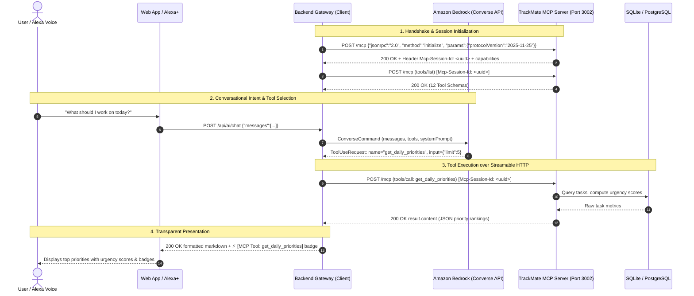

# TrackMate AI — System Architecture

**Amazon Developer Hackathon 2026**  
*Primary Track: Alexa+ | Mini Challenges: AWS Builder, Open Source*

---

## 1. High-Level Architecture

TrackMate AI is engineered as an enterprise-grade agentic productivity system. It decouples the client interface, backend orchestration, model inference, and tool execution into discrete, independently testable microservices.

```
┌─────────────────────────────────────────────────────────────┐
│                       CLIENT LAYER                          │
│           React 18 + Vite + SPA Router + TanStack Query     │
│       Dashboard │ Projects │ Tasks │ Team │ AI Assistant    │
└──────────────────────────────┬──────────────────────────────┘
                               │ HTTP / REST (/api/*)
                               ▼
┌─────────────────────────────────────────────────────────────┐
│                     BACKEND GATEWAY (Node/TS)               │
│                            Port 3001                        │
│   • REST Routes (/projects, /tasks, /users)                 │
│   • Express Rate Limiting (General & AI)                    │
│   • Zod Schema Validation & CORS Middleware                 │
│   • AI Agent Service (Amazon Bedrock Converse / Mock)       │
│   • MCP Streamable HTTP Client                              │
└──────────────┬───────────────────────────────┬──────────────┘
               │                               │
               │ SQL Queries                   │ JSON-RPC 2.0 (Streamable HTTP)
               ▼                               ▼
┌─────────────────────────────┐  ┌────────────────────────────┐
│      PERSISTENCE LAYER      │  │      MCP SERVER (Node/TS)  │
│  SQLite (dev) / PostgreSQL  │  │           Port 3002        │
│  Drizzle ORM Type-Safe      │  │  • Spec: 2025-11-25        │
│  Relational Schema          │  │  • Transport: POST /mcp    │
│  Foreign Keys + Triggers    │  │  • 12 Executable Tools     │
└──────────────▲──────────────┘  │  • Session: Mcp-Session-Id │
               │                 └─────────────┬──────────────┘
               │                               │
               └───────────────┬───────────────┘
                               │ Reads/Writes Database
                               ▼
┌─────────────────────────────────────────────────────────────┐
│                      AI / REASONING LAYER                   │
│   • Amazon Bedrock (anthropic.claude-3-5-sonnet-20241022)   │
│   • Converse API with Autonomous Function Calling Loop      │
│   • Transparent Execution: Emits Real-Time Tool Badges      │
│   • Resilient Offline Mock Provider (Zero Creds Required)   │
└─────────────────────────────────────────────────────────────┘
```

---

## 2. MCP Protocol Implementation (Spec 2025-11-25)

The Amazon Developer Hackathon Alexa+ track requires a self-hosted MCP server implementing the **2025-11-25 specification** using **Streamable HTTP**.

### Protocol Flow



### Transport Specifications

1. **Endpoint**: `POST /mcp` — Unified Streamable HTTP endpoint for all JSON-RPC 2.0 messages.
2. **Session Header**: All subsequent requests include `Mcp-Session-Id: <uuid>`.
3. **Chunked Streaming & SSE**:
   - `Accept: application/json` returns standard JSON-RPC 2.0 response objects.
   - `Accept: text/event-stream` initiates chunked Server-Sent Events (SSE) streaming for long-running tool results.
4. **Health Check**: `GET /health` returns `{ "status": "ok", "transport": "streamable-http", "mcpSpec": "2025-11-25" }`.

---

## 3. Microservice Packages

| Package | Path | Description |
|---|---|---|
| `@trackmate/shared` | `packages/shared` | Shared TypeScript types, Zod schemas, MCP contract interfaces |
| `@trackmate/database` | `packages/database` | Drizzle ORM schema, SQLite/PostgreSQL client, migrations & seeds |
| `@trackmate/mcp-server` | `packages/mcp-server` | Standalone MCP Server running on port 3002 with 12 tools |
| `@trackmate/backend` | `packages/backend` | Express API gateway, Bedrock Converse client, MCP HTTP consumer |
| `@trackmate/frontend` | `frontend/` | React 18, Vite, TanStack Query, Lucide icons, responsive CSS tokens |

---

## 4. Security & Production Readiness

- **CORS**: Configured with strict origin validation (`http://localhost:5173` or environment URL).
- **Rate Limiting**: Multi-tier rate limiting using `express-rate-limit` (100 req/15min for general API, 20 req/min for AI endpoints).
- **Zod Schema Validation**: All MCP tool invocations and REST endpoints validate JSON input strictly.
- **Defensive Error Handling**: All network calls to third-party APIs (GitHub REST API, Bedrock runtime) have graceful fallback paths to prevent container or thread crashes.
